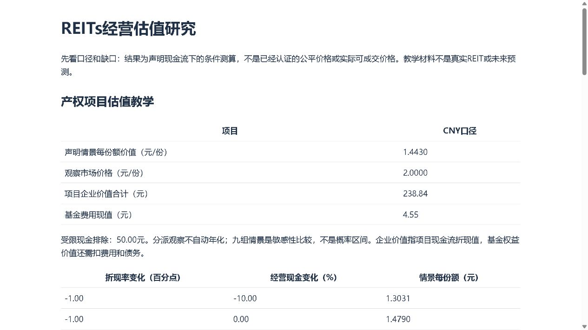

# REITs经营与估值研究

把项目经营现金流、费用、债务和基金份额连起来，研究声明情景下的每份额价值、扩募变化与实际分派。产权类与有限经营权类分别核对终值和期限。

## 你可以这样问

这只REIT分派高，是经营现金充足，还是剩余期限较短？扩募后基金总价值增加，每份额也增加了吗？受限现金能算进可归属价值吗？

## 先试一次

需要Python 3.10+，只用标准库，无需其他作者仓库或行情密钥。
Windows运行Start-Demo.cmd，或执行 `python try_demo.py`；Linux/macOS用 `sh Start-Demo.sh`。
打开新目录report.html，包含产权、经营权、扩募、可供分配金额与全周期IRR五组原创教学案例。教学不是实际REIT或投资预测。

## 名称与安装

仓库、发行包、命令和Skill注册名：`cn-reits-research`；Python模块：`cn_reits`。
在独立环境执行 `python -m pip install .`，然后 `cn-reits-research --help`。Skill保留完整资源，不因pip安装自动注册。

## 能得到什么

| 问题 | 输出 |
|---|---|
| 多项目如何折现 | 税后未扣资本支出/营运资金的经营现金，逐项扣维护与增长资本支出及营运资金增量，按实际日期折现 |
| 项目价值如何变成份额价值 | 按明确项目归属加总，扣基金费用现值，加可归属额外现金与非经营资产，减债务与其他优先索偿，再除总份额 |
| 经营权到期如何处理 | 检查现金流覆盖到期日，明确到期回收，不套产权项目退出假设或默认永续增长 |
| 扩募是否增厚 | 新项目价值、收购对价、新份额、发行费、新债及剩余资金逐项桥接，比较每份额；不默补融资 |
| 分派与可供分配是否一致 | 分派所属期间与支付日期分别观察，金额/份额核对；可供分配由利润和明确调整桥接，不当作实际支付 |
| 分派率与全周期收益率区别 | 明确期间的实际现金分派率不自动年化；传统现金流全周期IRR使用ACT/365，非传统可能多解时不挑根 |

## 使用自己的资料

先看[资料准备](BEGINNER.md)和[方法](METHODS.md)。缺少未来费用、权利期限、债务或份额不能填零后声称完整估值。
这套模型覆盖完整声明底稿的现金流到权益测算，不能自动取得任意REIT的全部资料，不是正式资产评估、完整会计分类或公平价格认证。
产权项目的声明退出值仍需研究剩余权利与买方假设；经营权到期回收不能默认继续经营。项目未来现金流和情景都是假设。

## 来源与工具分工

经营披露阅读参考[上交所REITs审核关注事项](https://www.sse.com.cn/lawandrules/sselawsrules2025/reits/c/c_20251231_10803742.shtml)。分派制度参考[证监会基础设施基金指引说明](https://www.csrc.gov.cn/csrc/c100028/c1000722/content.shtml)，每个标的仍核对适用品种、日期与原文。
工作台组织资料与档案，规则库处理制度版本，财报仓核对原表金额，本仓维护估值模型；以上工具均可独立使用。
原创代码MIT，第三方和数据权利见[许可说明](THIRD_PARTY_NOTICES.md)，不公开原PDF或个人账户。

经营驱动 `operating`、债务计划 `debt`、分配公告 `distribution-plan` 均为独立入口。完整底稿及真实公告案例见 [PUBLIC_CASES.md](PUBLIC_CASES.md)。公开案例缺未来现金流，不自动生成真实产品公平估值。

[限定性能记录与复现方法](PERFORMANCE.md)。

[本轮审计范围与未认证事项](AUDIT_SCOPE.md)。

## 报告预览

下图为实际浏览器中的原创教学报告；[完整报告文件](examples/reits-demo-accepted/report.html)、[手机验收和文件绑定](examples/reits-demo-accepted/browser-acceptance.json)可以随源码下载复查。

[模型、独立使用与浏览器验收范围](VALIDATION.md)。

当前版本：[v0.1.2](https://github.com/KILING-TASI/cn-reits-research/releases/tag/v0.1.2)。发布页提供完整源码、wheel、sdist与校验清单；三个包仅用标准库，pip安装不自动注册Skill。

v0.1.1 修复冻结示例在分发时的换行转换，恢复验收原始字节；模型和原收据不改写。v0.1.0旧标签/附件保留，查看冻结样本请使用补丁版。

v0.1.2 统一包内软件版本与发行版本，保留v0.1.1的冻结字节修复；条件估值方法和历史收据不变。当前下载使用v0.1.2，旧标签/附件保留。
